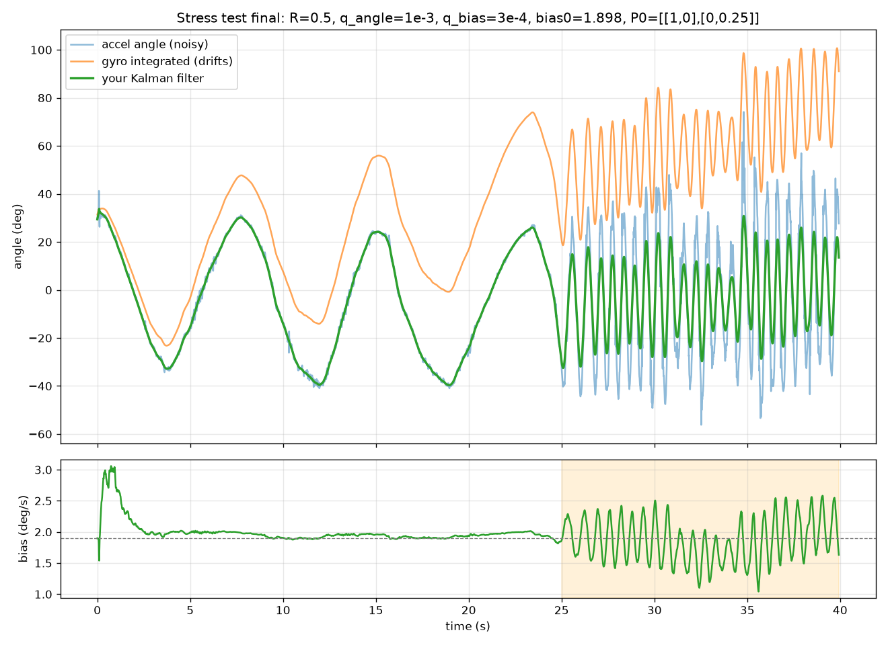

# Tumbller Kalman filter

A two-state Kalman filter (tilt angle and gyro bias) for an ELEGOO Tumbller self-balancing robot. I implemented it in Python, tuned it on recorded IMU data, and replaced the robot's stock angle estimator with it. The robot balances using my filter and ELEGOO's controller.

Video: <https://youtu.be/WhMmGBub5ZQ?si=Vmh3gE-xhbO7U2gz>

The plot is one recording from the robot's IMU: slow tilts, then hard shaking at the end. Blue is the angle from the accelerometer, orange is the gyro integrated over time, and green is the filter. The lower plot is the filter's estimate of the gyro bias.

## What I did

- Recorded the IMU at 100 Hz over serial (`python/record_imu.py`).
- Measured the gyro bias and sensor noise with the robot sitting still for 20 seconds.
- Implemented the filter in Python (`python/analyze_tilt.py`) and tuned it on the recordings.
- Ran a stress test: slow tilts, then hard shaking.
- Had the filter translated to C++ and put it in the robot's firmware in place of ELEGOO's angle estimator. ELEGOO's controller, PID gains, and timer are unchanged.

## How it works

The filter tracks the tilt angle and the gyro bias. At each step the gyro reading, minus the current bias estimate, predicts the new angle. The accelerometer angle then corrects that prediction. The size of the correction depends on how uncertain the filter is about its angle compared with the accelerometer's noise.

## Results

With the robot at rest, the gyro bias was 1.898 deg/s. When the filter's bias estimate started at zero, it settled near 1.9 to 2.0 deg/s.

In the shaking test, the accelerometer angle swings widely and the integrated gyro drifts away. The filter stays smooth and does not drift.

The accelerometer noise at rest was 0.0425 deg². I used 0.5 deg² in the filter because the accelerometer is noisier when the robot moves. I also lowered the bias process noise from 3e-3 to 3e-4, which reduced the swing of the bias estimate during shaking from 4.5 to 1.5 deg/s. Final constants: q_angle 1e-3, q_bias 3e-4, R 0.5, initial bias 1.898 deg/s.

## What is missing

- I did not check the angle against a known reference angle.
- I did not compare it with ELEGOO's stock filter.
- During fast shaking the bias estimate still moves about 1.5 deg/s peak to peak. Skipping the accelerometer update when its magnitude is far from 1 g would probably help. I did not try it.
- The starting bias value is specific to my unit.
- The robot sometimes shakes briefly before it settles. I have seen this on the stock firmware too, but I did not test it or look into the cause.

## AI help

Claude (Anthropic) helped explain the Kalman filter theory, reviewed and corrected my code, translated my Python filter to C++, and wrote the data-logging and plotting scripts.

## Files

- `python/`: serial recorder, and the filter with plotting
- `firmware/tumbller_logger/`: Arduino sketch that streams IMU data
- `firmware/kalman_port/`: my C++ filter code, which replaces ELEGOO's `Angle()` function
- `data/`: recordings
- `figures/`: plots

## ELEGOO

The robot, firmware, and controller are by ELEGOO. Their code is not included here. It is in their [tutorial repo](https://github.com/elegooofficial/ELEGOO-TumbllerV1.1-Self-Balancing-Car-Tutorial). To run my filter, replace `Angle()` in `KalmanFilter.cpp` with the code in `firmware/kalman_port/` and add the new members to `KalmanFilter.h`.
